# Motorsport vehicle rig for 3ds Max

Rig an imported car in 3ds Max and drive it along any spline. One dialogue
measures the vehicle from its meshes, builds a rig without touching the
model's geometry, plans a grip-limited drive and bakes editable keys:
steering, wheel spin, body roll, pitch and heave, all kept inside the
model's own wheel arches.

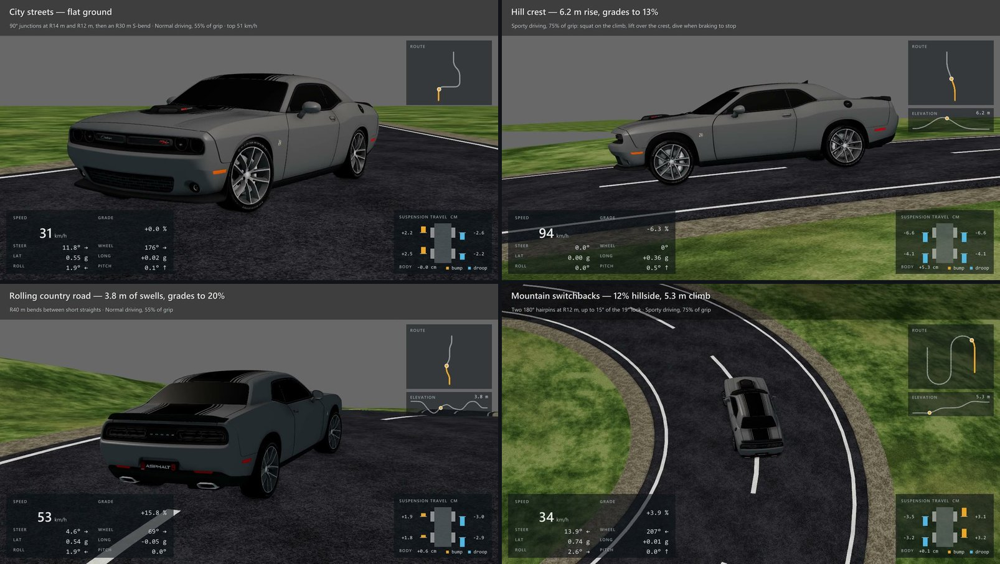

<sub>Viewport previews (Shift+V) of one rigged Dodge Challenger on four test
roads. The readouts were measured from the baked scene and added to the
previews afterwards; they are not part of the script.</sub>

## Contents

- [What it does](#what-it-does)
- [Install](#install)
- [Use it](#use-it)
- [How it works](#how-it-works)
- [Best results](#best-results)
- [Troubleshooting](#troubleshooting)
- [Showcase](#showcase)
- [Tests and project layout](#tests-and-project-layout)

## What it does

- **Rigs an imported vehicle non-destructively.** *Auto Assemble* sorts the
  model's meshes into body, wheels, brakes and steering wheel by name. Every
  node it moves keeps a record of its original parent and transform, so
  *Remove* puts the model back exactly as it was.
- **Measures the vehicle** from its evaluated meshes, not its pivots: wheel
  centres, tyre radius, ground plane, wheelbase, track and facing. When the
  scene's units would make the car implausibly sized, it fits the scale to
  the vehicle preset and says so.
- **Measures the wheel arches**: how far each corner can compress and how far
  the front wheels can steer before a tyre would touch the body.
- **Plans a realistic drive**: cornering speed is limited by tyre grip,
  braking and acceleration share that grip, acceleration tapers with speed,
  and the car starts and stops at rest. Four driving styles set how much of
  the grip the driver uses.
- **Bakes every frame**: both axles on the path, Ackermann steering, wheel
  spin from the distance travelled, the steering wheel turning on its own
  column, and body roll, pitch and heave from a spring-damper.
- **Checks before it bakes.** *Preflight* names the knot at fault on a broken
  spline and warns where a corner needs more steering than the car has.
- **Stays editable.** Keys go on a *Generated Path* controller layer; a
  *Manual Offset* layer on top is free for hand edits.

## Install

**Requirements:** 3ds Max 2027. No plugins and no network access are needed.
The script was verified on 3ds Max 2027 only; treat other versions as
untested.

1. Download [`maxscript/VehicleRigTool.ms`](maxscript/VehicleRigTool.ms), or
   clone this repository.
2. In 3ds Max choose **Scripting > Run Script...** and open
   `VehicleRigTool.ms`, or drag the file into a viewport. The **Vehicle Rig**
   panel opens.
3. *Optional, a toolbar button.* Open the MAXScript Listener (F11), run the
   lines below with your own path, then go to **Customize > Customize User
   Interface > Toolbars**, choose the category **Vehicle Rig** and drag
   **Vehicle Rig** onto a toolbar.

   ```maxscript
   macroScript VehicleRigTool category:"Vehicle Rig" buttonText:"Vehicle Rig" tooltip:"Open the vehicle rig dialogue"
   (
       fileIn @"C:\Tools\VehicleRigTool.ms"
   )
   ```

Running the script again closes the open panel and opens a fresh one.

## Use it

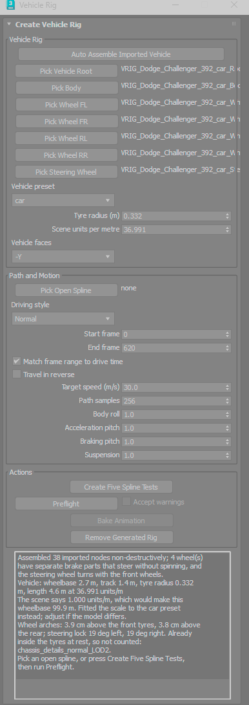

### 1. Assemble the vehicle

Select all of the vehicle's meshes and press **Auto Assemble Imported
Vehicle**. Parts are sorted by their names (any letter case):

| Part | Name contains | Rig behaviour |
| --- | --- | --- |
| Wheels | `wheelFL`, `wheelFR`, `wheelBL`, `wheelBR` | front wheels steer; all spin |
| Brakes | the wheel's token and `caliper` or `brake`, e.g. `wheelFL_caliper` | steer with their wheel, never spin |
| Steering wheel | `steeringwheel`, `steering_wheel` or `Steering Wheel` | turns with the front wheels |
| Everything else | | body |

The report lists what was found and measured: wheelbase, track, tyre
radius, length, the gap above each tyre and the steering lock the arches
allow.

No usable names? Use the pick buttons instead: **Pick Vehicle Root**,
**Pick Body**, the four wheels and, optionally, the steering wheel. Every
picked node must sit under the root.

Then check the measured fields: **Vehicle preset** (car, SUV, pickup, van
or bus), **Tyre radius**, **Scene units per metre** and **Vehicle faces**.

### 2. Pick a path

Draw an open spline where the centre of the car should drive, then press
**Pick Open Spline** and click it. To try the rig first, **Create Five
Spline Tests** adds four valid test roads and one with a duplicate knot that
Preflight must reject.

### 3. Preflight

Choose the **Driving style** and **Target speed**, then press **Preflight**.
It never changes the scene. It reports the path length, drive time, top
speed and the frames the bake will use. Errors block the bake; warnings must
be read and accepted with **Accept warnings**.

<br clear="right">

<table>
  <tr>
    <td width="400">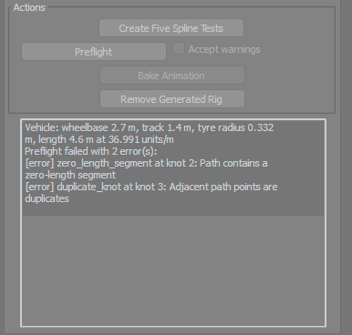</td>
    <td><b>Preflight error.</b> The bad knots are named, so you know which one to weld. Nothing can be baked until the spline is fixed.</td>
  </tr>
  <tr>
    <td width="400">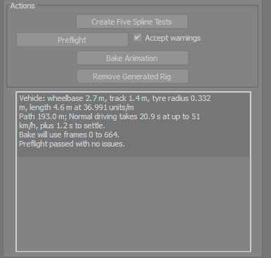</td>
    <td><b>Preflight passed.</b> 193 m of road and 20.9 s of driving at up to 51 km/h; the bake will use frames 0 to 664. With no warnings, Accept warnings is ticked for you and Bake Animation is enabled.</td>
  </tr>
  <tr>
    <td width="400">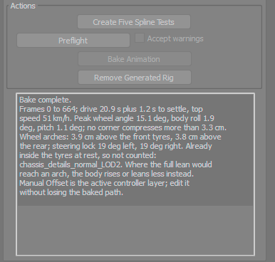</td>
    <td><b>Bake complete.</b> A summary of the drive (top speed, peak steering, roll and pitch) and of the wheel-arch clearance it kept.</td>
  </tr>
</table>

### 4. Bake

Press **Bake Animation**. Keys are written on every frame from the start
frame. With **Match frame range to drive time** ticked, the end frame is the
drive time plus 1.2 s for the body to settle after the stop. Bake again to
try another style or spline; it replaces the previous bake.

### 5. Edit or remove

Each helper has two controller layers: **Generated Path** holds the bake and
**Manual Offset**, the active layer, starts empty. Animate on Manual Offset
to adjust the motion without losing the bake. **Remove Generated Rig**
deletes the `VRIG_` helpers and restores every node's parent and transform;
test splines are kept. Assemble, Bake and Remove are each one undo step.

### Dialogue reference

| Control | What it does |
| --- | --- |
| Vehicle preset | Grip, braking, acceleration, roll and pitch per g, ride frequency and steering ratio for a car, SUV, pickup, van or bus. |
| Tyre radius (m) | Filled from the wheels; sets how fast the wheels spin. |
| Scene units per metre | Filled from the model; converts scene units to metres. |
| Vehicle faces | The measured forward axis. Change it only if the report shows the wrong one. |
| Driving style | Share of the tyre grip the driver uses: Relaxed 35 %, Normal 55 %, Sporty 75 %, Limit 100 %. |
| Start frame, End frame | The bake range. The end frame is set for you when the next option is ticked. |
| Match frame range to drive time | Physical timing. Untick it to fit the drive into Start to End instead. |
| Travel in reverse | Drives the spline from its last knot to its first. |
| Target speed (m/s) | Top speed on straights; 30 m/s is 108 km/h. |
| Path samples | Minimum samples along the spline; at least two per metre are always used. |
| Body roll, Acceleration pitch, Braking pitch, Suspension | Scale each response from 0 (off) to 1 (physical). |

## How it works

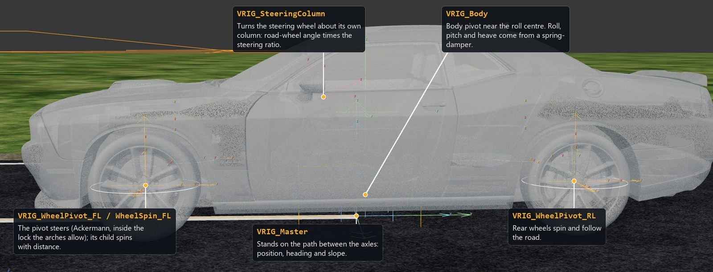

Every generated node is a `VRIG_` helper; the model's own meshes are only
re-parented under them, with their original parent and transform recorded.
`VRIG_Master` carries the car along the path, `VRIG_Body` carries the body
and leans it, each wheel hangs from a pivot that steers with a child that
spins, and the steering wheel turns about its own column.

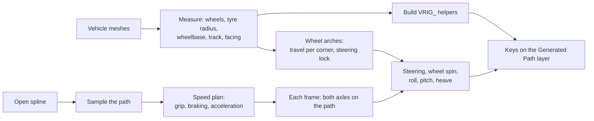

1. **Measure.** Wheel centres, tyre radius and the ground plane come from the
   wheel meshes' bounds; wheelbase, track and facing from the four wheel
   centres. The scale is fitted to the preset wheelbase when the scene units
   would make the car implausible.
2. **Wheel arches.** The tyres are tested against the body meshes around
   them to find how far each corner can compress and how far the front
   wheels can turn each way. Inner liners that already sit inside a tyre at
   rest are ignored.
3. **Speed plan.** The spline is sampled at least twice per metre. Cornering
   speed is capped where the grip in use runs out; a forward pass adds
   acceleration that tapers with speed, and a backward pass adds braking,
   both sharing the grip with cornering (a friction circle). The drive
   starts and ends at rest, and within each sample span the car accelerates
   smoothly rather than in steps.
4. **Pose.** The rear axle stands half a wheelbase behind the car's centre
   and the front axle half a wheelbase ahead, both on the path. The line
   between them gives the heading and slope, so a corner turns the car over
   its own length and nothing can drift off the path.
5. **Steering and wheels.** The front wheels take Ackermann angles plus
   understeer at speed, stopped at the lock the arches allow. The steering
   wheel turns by the road-wheel angle times the steering ratio. Each wheel
   spins by the distance travelled over its tyre radius.
6. **Body.** Roll and pitch follow the lateral and longitudinal g through the
   preset's roll, squat and dive gradients; heave comes from crests and dips
   in the road. A spring-damper at the preset's ride frequency makes the
   body settle rather than snap. The pose is kept inside each corner's arch
   travel, lifting the body before reducing its lean, and near the limits
   every frame is checked against the arches themselves.
7. **Keys.** Every helper is keyed on every frame on its Generated Path
   layer.

## Best results

### The vehicle model

- **Separate wheel meshes.** Each wheel (tyre and rim) must be its own mesh
  or group, apart from the body. Put brake discs or calipers in their own
  meshes named with `caliper` or `brake` so they steer without spinning.
- **Name the parts** with `wheelFL`, `wheelFR`, `wheelBL` and `wheelBR`
  for Auto Assemble. An imported parent that holds both wheel and body parts
  cannot be split; ungroup or detach it first.
- **Model at rest:** the car level on its wheels, tyres touching flat ground,
  wheels pointing straight ahead, facing along X or Y.
- **Real-world size** gives the cleanest result. If the report shows a
  wheelbase that is not your car's (2.4 to 3.2 m for most cars), set **Scene
  units per metre** yourself.
- **Modelled wheel arches** give an accurate clearance. The report states the
  gap above each tyre and the steering lock; a car without arch geometry
  gets generous limits.
- **Pick the closest preset.** It sets grip, braking, roll and pitch per g,
  ride frequency and steering ratio.

### The spline

- **One open spline**, drawn where the centre of the car should go, from
  start to finish (or tick **Travel in reverse**).
- **On the road surface.** The rig stands the tyres on the spline's height;
  it does not read the road mesh. On terrain, snap the knots to the road or
  build the spline from the road's centreline, and keep the road level
  across under the car.
- **Smooth knots** a few metres apart. Corner knots make the car round the
  kink over its wheelbase, and Preflight warns about them.
- **Corners the car can make.** The tightest radius at walking pace is about
  wheelbase / tan(steering lock): about 8 m for a 2.7 m wheelbase and a 19°
  lock, more at speed. Preflight reports any stretch that needs more lock
  than the car has.
- **No duplicate or zero-length knots** (errors), no self-crossing (warning),
  and a path longer than the car.
- **Smooth crests and dips** give natural heave. The showcase roads reach
  grades of 20 % without trouble.

### Settings

- **Set the scene frame rate before baking**; keys are written on every
  frame.
- **Keep Match frame range to drive time ticked** for physical timing. Fit a
  fixed range only when the edit demands it, since the motion is then sped
  up or slowed down.
- **Driving style:** Relaxed or Normal for road scenes, Sporty or Limit for
  spirited driving. At Limit the body leans hard enough that the bake may
  ease it back near the arches; the report says how many frames.
- **Leave Body roll, Acceleration pitch, Braking pitch and Suspension at 1**
  for physical motion; lower them for a calmer style.

### Viewport previews (Shift+V)

- Parent chase cameras to `VRIG_Master` so they ride with the car but not
  with its body roll.
- In a large scene, turn on the camera's **Clip Manually** with a near plane
  of about 0.3 to 0.5 m. With the default near plane of one scene unit,
  surfaces a few centimetres apart flicker in the distance.
- The **Realistic** visual style with shadows and ambient occlusion shows
  body roll and pitch best.

## Troubleshooting

| Message | What to do |
| --- | --- |
| Select the imported vehicle mesh nodes before assembly. | Select the car's meshes, then press Auto Assemble. |
| Missing wheel cluster FL. | No mesh name contains `wheelFL`. Rename the wheel or use the pick buttons. |
| *node* holds parts of both the body and wheel FL. | Ungroup or detach that parent so each holds one part of the car. |
| VRIG_..._Root already exists. | Press Remove Generated Rig, then assemble again. |
| The scene says ... units/m ... Fitted the scale to the car preset instead. | Information only. Set Scene units per metre yourself if your car is a different size. |
| `[error] duplicate_knot` or `zero_length_segment at knot N` | Weld or delete knot N of the spline. |
| `[warning] steering_limit` | The corner is tighter than the lock allows; widen it, or accept and the wheels stop at the lock. |
| `[warning] sharp_kink` | Make that knot smooth or move it. |
| `[warning] self_intersection` | Split the path where it crosses itself. |
| `[warning] path_shorter_than_vehicle` | Use a longer path. |
| In N frame(s) the body was eased back so an arch would not touch a tyre. | Information only: the rig held the body inside the arches. |

## Showcase

The previews in this README were recorded with Make Preview (Shift+V) on
roads built for testing: graded asphalt with painted lines on terrain, with
a sun and sky light. Only the vehicle motion comes from the rig.

<table>
  <tr>
    <td width="50%">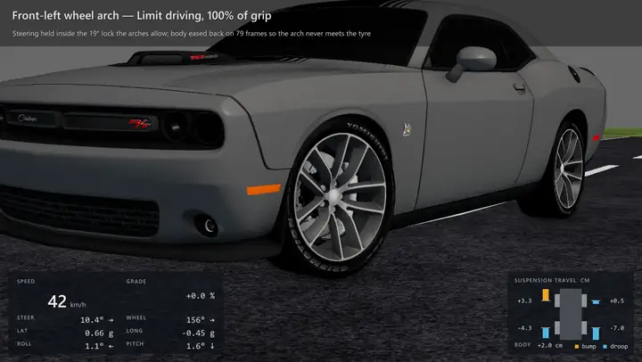</td>
    <td width="50%">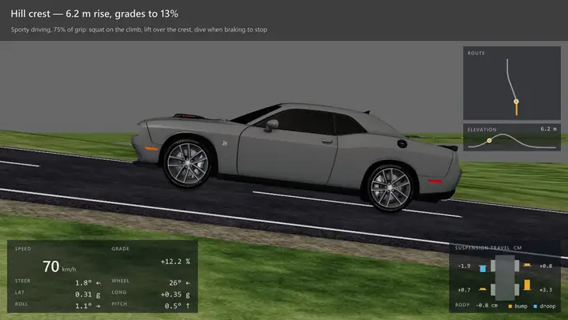</td>
  </tr>
  <tr>
    <td><b>Limit driving, front-left arch.</b> At about 1 g the outer tyre is loaded and the body leans 3.3°, yet the arch never touches the tyre.</td>
    <td><b>Hill crest at 94 km/h.</b> The body lifts 5 cm as the road falls away and every wheel droops; it squats on the climb and dives when braking.</td>
  </tr>
</table>

| Road | Spline and terrain | What to watch |
| --- | --- | --- |
| 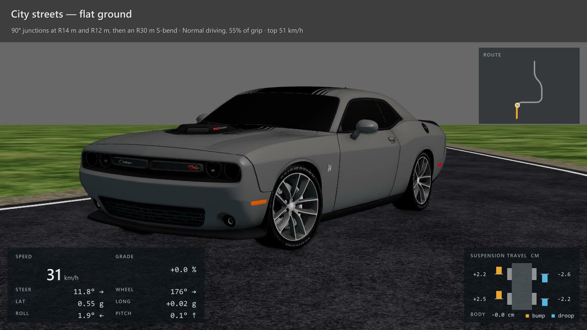 | Flat streets: 90° junctions at R14 m and R12 m, an R30 m S-bend. Normal style, top speed 51 km/h. | Braking into each junction, steering to 15°, the body leaning out of the turn. |
| 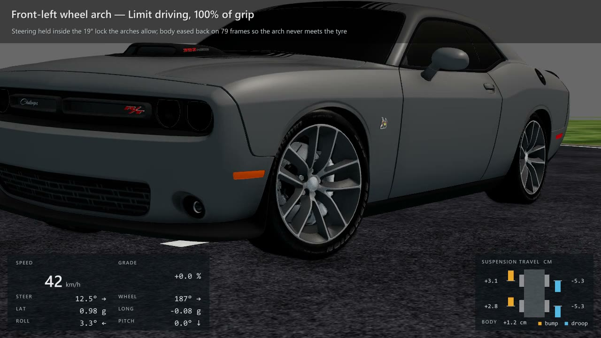 | The same streets at Limit. | Tyre-to-arch clearance with the steering near its lock. |
| 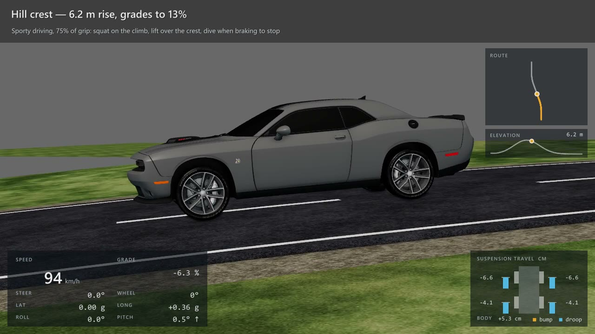 | A 6.2 m hill with grades to 13 %. Sporty style. | Squat, lift over the crest and dive at the stop. |
| 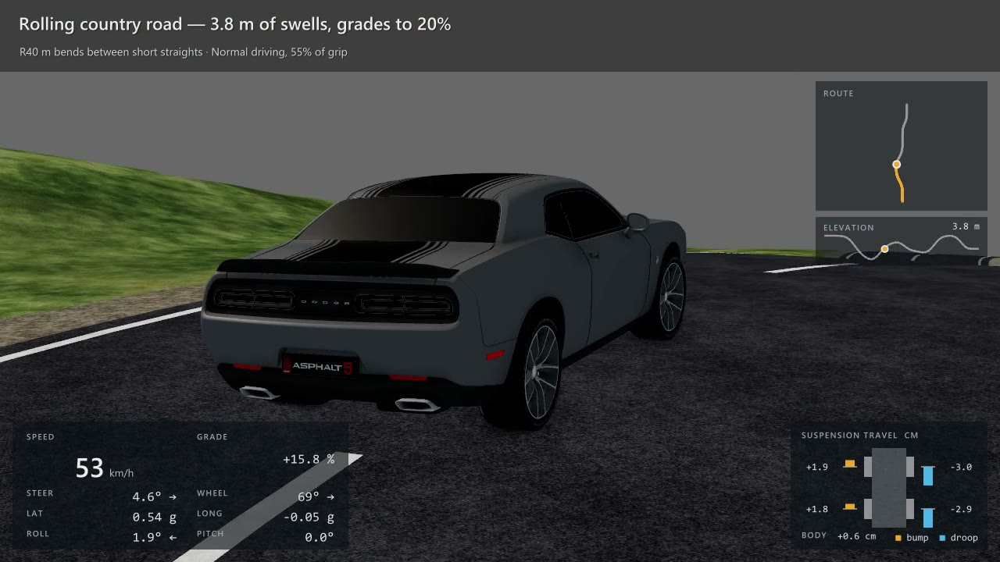 | 3.8 m of swells with grades to 20 % and R40 m bends. Normal style. | Pitch following the swells while the car corners. |
| 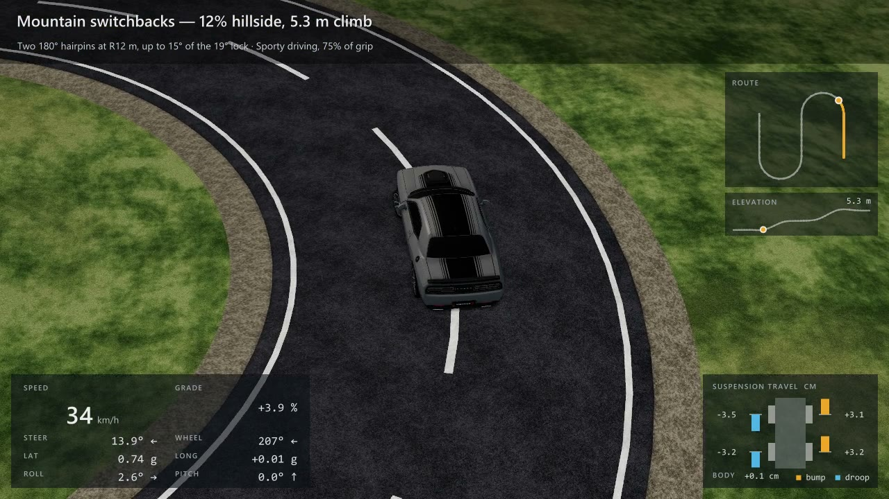 | A 12 % hillside with two 180° hairpins at R12 m. Sporty style. | About 15° of steering, the steering wheel past 200°, the body leaning out of each hairpin. |

In every run above no tyre touched an arch on any frame, no corner
compressed more than its measured travel, and the wheels never spun
backwards.

## Tests and project layout

```
maxscript/   VehicleRigTool.ms, the 3ds Max rig dialogue
server/      host-independent vehicle geometry and motion modules
tests/       automated checks
docs/        design notes, plans and README images
```

The Python modules hold the maths the MaxScript mirrors: presets, the speed
plan, steering, spring-damper body motion and the two-axle path pose. The
tests check that maths and the script's contract offline; they need Python
3.11 or later and pytest, and no network connection:

```
python -m pytest tests -q
```

Behaviour in the viewport was verified on 3ds Max 2027.
